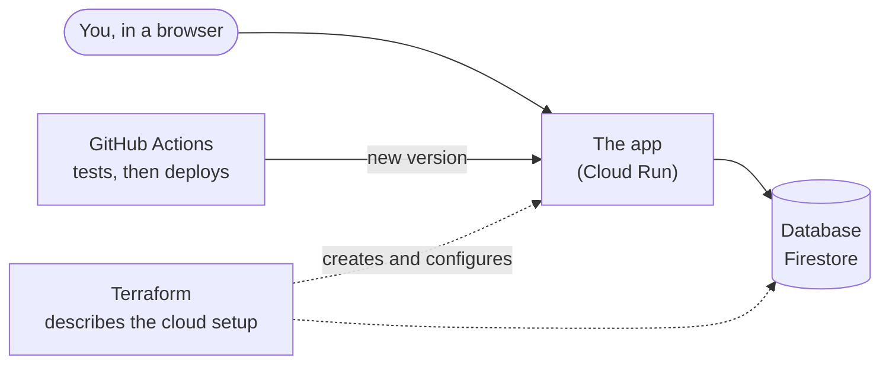

# TaskApp

A to-do list where tasks are sorted into categories, built with Next.js and running on Google Cloud. Google sign-in and Google Calendar sync are on the way.

## Why build a to-do app like this?

Honestly, a to-do list doesn't need any of the infrastructure behind this one. I built it this way on purpose.

I wanted a project small enough that the app itself stays simple, so I could spend my effort on everything around it: automated deployments, infrastructure as code, cloud security and testing. In other words, the things that make software safe to run in production. So the app is deliberately overengineered, and that's the point.

**Where it's at:** the app works, stores data in Firestore and deploys itself on every merge. I'm now building category management. See the [roadmap](#roadmap).

## How it fits together



- **The app** is a single Next.js project that serves both the pages and the API. It runs on Cloud Run, which starts it when someone visits and scales it back down to zero when nobody does, so it costs almost nothing.
- **The data** lives in Firestore, Google's document database.
- **Every merge to `main`** is tested and then deployed automatically by GitHub Actions. Nobody deploys by hand.
- **The cloud setup** (database, permissions, the service itself) is written as code with Terraform, so it can be reviewed, versioned and rebuilt rather than clicked together in a console.

## What I focused on

**No passwords or keys for the pipeline.** GitHub Actions needs permission to deploy, but storing a cloud key in GitHub is a common way for credentials to leak. Instead, each deployment proves it comes from this repository and gets a temporary pass that expires within the hour ([Workload Identity Federation](https://cloud.google.com/iam/docs/workload-identity-federation)). There are no keys to steal.

**Every part gets only the access it needs.** The running app can read and write the database, and nothing else. The deployment pipeline can publish new versions, but it can't read anyone's data.

**Moving existing infrastructure into code without breaking it.** I first set things up by hand to learn how they worked, then brought each piece under Terraform. Each import was checked to change nothing at all before it was applied, and the most important resources are protected from accidental deletion.

**Tests that hold every version to the same rules.** The app can store data in memory (fast, for development) or in Firestore (for real). Both have to pass the same set of tests, so they can't quietly behave differently.

**Writing down the reasoning.** Bigger design choices are recorded as short [decision records](docs/decisions/README.md): what I chose, what I considered instead, and why. For example, one covers how to stop two people creating the same category at the same moment.

**A protected main branch.** Nothing reaches `main` without passing the tests, a Docker build and a Terraform check, and GitHub blocks any push that looks like it contains a secret.

## Built with

| Area           | Tools                                 |
| -------------- | ------------------------------------- |
| App            | TypeScript, Next.js 16, React 19, Zod |
| Database       | Firestore                             |
| Testing        | Vitest, Firestore emulator            |
| Hosting        | Google Cloud Run, Docker              |
| Infrastructure | Terraform                             |
| CI/CD          | GitHub Actions                        |

## Try it locally

You'll need Node.js 24 or later. No cloud account is needed: by default the app keeps tasks in memory.

```bash
cd task-app
npm install
cp .env.example .env.local
npm run dev
```

Then open http://localhost:3000. Tasks reset when you restart the server.

To run the checks that CI runs:

```bash
npm run lint
npm run typecheck
npm run test:run
```

More detail on scripts and settings is in [task-app/README.md](task-app/README.md), and deployment is covered in [docs/deploy.md](docs/deploy.md). There's no public link yet: the app stays private until sign-in is built, so strangers can't use it.

## Roadmap

| Phase                 | What it adds                                                 | Status      |
| --------------------- | ------------------------------------------------------------ | ----------- |
| 1. Foundations        | Add, complete and delete tasks                               | Done        |
| 2. Persist and deploy | Database, automatic deployment, infrastructure as code       | Done        |
| 3. Categories         | Create, rename and delete categories; group and filter tasks | In progress |
| 4. Google sign-in     | Each person sees only their own tasks                        | Planned     |
| 5. Google Calendar    | Turn tasks with due dates into calendar events               | Planned     |
| 6. Polish             | End-to-end tests, monitoring, a demo and a live link         | Planned     |
